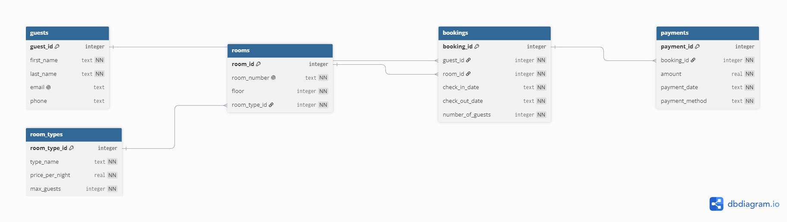

# Hotel Booking Database

This is a relational database for a small hotel. It stores guests, room types, rooms, bookings and payments, and can answer questions such as: Which rooms are free between two dates? Which room type is the most popular? How much money has the hotel taken?

I built it because I worked in the hotel industry as a Receptionist and Duty Manager. I understand how hotel booking systems work from the front desk, and I wanted to build one myself to understand how a system keeps track of guests, rooms and bookings behind the scenes.

## Database Design

The database has 5 linked tables: guests, room types, rooms, bookings and payments. Each booking links one guest to one room, and each payment belongs to one booking.




## Tables

| Table | What it stores |
|---|---|
| guests | Guest names, emails and phone numbers |
| room_types | Room types (Single, Double, Twin, Family, Suite) with price per night and maximum guests |
| rooms | Each room's number, floor and room type |
| bookings | Which guest stayed in which room, check-in and check-out dates, and number of guests |
| payments | Amount, date and method of payment for each booking |

## Files

| File | Description |
|---|---|
| `schema.sql` | Creates the 5 tables with primary keys and foreign keys |
| `sample_data.sql` | Sample data: 5 room types, 10 guests, 10 rooms, 12 bookings, 12 payments |
| `queries.sql` | 17 SQL queries that answer real hotel questions |
| `er-diagram.png.png` | Entity-relationship diagram of the database |

## Example Queries

**Which rooms are free between two dates?**
```sql
SELECT room_number FROM rooms
WHERE room_id NOT IN (
    SELECT room_id FROM bookings
    WHERE check_in_date < '2026-10-07'
    AND check_out_date > '2026-10-05'
);
```

**Which guests have stayed more than once?**
```sql
SELECT guests.first_name, guests.last_name, COUNT(*) AS number_of_bookings
FROM guests
JOIN bookings ON guests.guest_id = bookings.guest_id
GROUP BY guests.first_name, guests.last_name
HAVING COUNT(*) > 1
ORDER BY number_of_bookings DESC;
```

## How to Run

1. Install [DB Browser for SQLite](https://sqlitebrowser.org/) (free).
2. Create a new database.
3. In the **Execute SQL** tab, run `schema.sql` to create the tables.
4. Run `sample_data.sql` to add the sample data.
5. Run any query from `queries.sql`.

## Technologies

- SQL (SQLite)
- DB Browser for SQLite
- dbdiagram.io (ER diagram)
- Git and GitHub

## What I Learned

- Designing a relational database with primary keys and foreign keys
- Creating tables and inserting data with SQL
- Filtering and sorting with `WHERE` and `ORDER BY`
- Calculations with `COUNT`, `SUM`, `AVG` and `MAX`
- Combining tables with `JOIN`
- Grouping results with `GROUP BY` and filtering groups with `HAVING`
- Using subqueries to find available rooms
- Working with dates using `strftime`

## Author

**Upenco Fernandes**, BSc (Hons) Computing Science student, Ulster University
